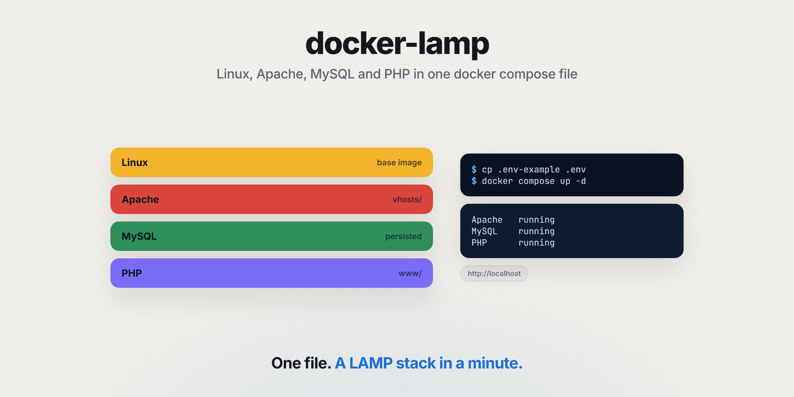

<div align="center">


# docker-lamp

**Linux, Apache, MySQL and PHP in one docker compose file. Up and running in a minute.**

<a href="https://github.com/smith89k/docker-lamp/blob/master/LICENSE"></a>


</div>

<picture>
  <source media="(prefers-color-scheme: dark)" srcset="art/banner-dark.png">
  
</picture>

Setup a LAMP instance using docker in a minute. It will be up and running with following services:
- Linux
- Apache
- MySQL
- PHP


## How to install?
1. To clone this repository: `git clone git@github.com:asifiqbal91/docker-lamp.git`
2. To create the `.env` file with default configuration: `cp .env-example .env`
3. Configure the environment vairables, if needed.
4. Create and configure virtual host(s) to the `vhosts` directory
5. Create page for each virtual host to the `www` directory
6. Add docker container to a network.
7. To compose the image and intialize the container: `docker-compose up -d`


### Example vhost configuration
```xml
<VirtualHost *:80>
	ServerName domain.com
	ServerAlias www.domain.com
	ServerAdmin admin@domain.com

	DocumentRoot document-web-root

	<Directory document-web-root>
		Options Indexes FollowSymLinks MultiViews
		AllowOverride All
		Order allow,deny
		Allow from all
		Require all granted
	</Directory>
</VirtualHost>
```


### How to add docker container to a network
```yaml
...
networks:
    [network_name_here]:
        external: true
```


## Want to Contribute?
You are welcome, if you want to create a pull request or help people with their issues. If you want to create a pull request, please open an issue first to discuss. Remember that this stack is not build for production usage, and changes should good for general purpose and not overspecialized.


## Want to Support?
You can help out the project by just ★ starring this repository from the [upper right corner](#) and also pinning it to your profile.


## License
This is released under the [MIT](https://choosealicense.com/licenses/mit/) license.
